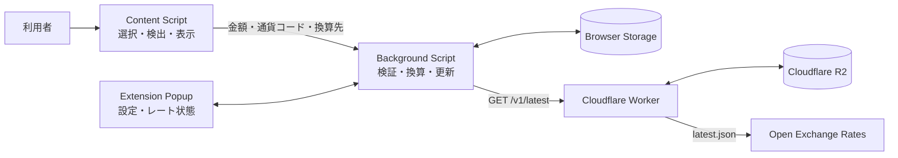

# アーキテクチャ

Currency Lensの通信設計は単純です。選択テキストの解析と換算をブラウザ内で行い、為替レートの取得だけをCloudflare Workerへ集約します。この文書では、実装から確認できるデータフロー、データの正本、信頼境界、失敗時の挙動を扱い、デプロイ先の初期設定は[デプロイとストア公開](deployment.md)へ分けます。

## 全体構成

R2は公開しません。Content ScriptとPopupからの外部通信、レートキャッシュ、換算処理はBackground Script、提供元APIとR2の境界はWorkerが所有します。

## コンポーネント

| コンポーネント       | 責務                                                                                                                                                        |
| -------------------- | ----------------------------------------------------------------------------------------------------------------------------------------------------------- |
| Content Script       | 選択範囲の監視、金額候補の検出、先頭1件の換算依頼、Shadow DOM内のUI表示                                                                                     |
| Background Script    | メッセージの検証、最大5件の換算先との一括換算、レート更新、設定とキャッシュへのアクセス                                                                     |
| Extension Popup      | 手入力換算、換算先通貨の即時保存、曖昧な記号設定、対応通貨一覧、レート日時と古さの表示                                                                      |
| Currency Lens Worker | `GET /v1/latest`と旧`GET /latest`、R2データの検証、空のR2の初期化、Cron Triggerによるレート更新、静的アセットとしての`GET /privacy`（プライバシーポリシー） |
| `packages/currency`  | 拡張機能が検出・設定・表示できる通貨コード、記号、換算精度のメタデータ                                                                                      |
| `packages/oxr`       | Open Exchange RatesのHTTPクライアント、timeoutとエラー分類、レスポンス検証                                                                                  |

## データの正本

| データ                           | 正本                                    | 補足                                            |
| -------------------------------- | --------------------------------------- | ----------------------------------------------- |
| 為替レートの値と提供時刻         | Open Exchange Ratesの検証済みレスポンス | Workerや拡張機能の取得時刻で上書きしない        |
| 配信中の最新スナップショット     | R2の`latest.json`                       | Workerが読み出すたびに検証する                  |
| 過去のスナップショット           | R2の提供元時刻別オブジェクト            | `latest.json`より先に保存する                   |
| 拡張機能が最後に利用できたレート | `browser.storage.local`                 | 更新失敗や古さだけでは削除しない                |
| 換算先通貨などのユーザー設定     | `browser.storage.sync`                  | 読み書き時に検証し、旧形式は移行する            |
| 検出・表示に対応する通貨         | `packages/currency`                     | OXR側の未知コードをUIの対応通貨へ自動追加しない |
| プロセス間メッセージの形         | `lib/messages.ts`のZodスキーマ          | 送信前と受信後の両方で検証する                  |

鮮度の基準は`sourceTimestamp`です。これはOpen Exchange Ratesの提供元時刻であり、拡張機能がWorkerから取得できた時刻は`fetchedAt`へ分けて記録します。

## データフロー

### 選択から換算まで

1. Content Scriptが通常のWebページで選択テキストを受け取ります。
2. 通貨コード、通貨記号、数値の区切り、万・億やmillionなどの単位をページとブラウザのロケールも使って解析し、選択範囲内の金額候補を出現順に検出します。
3. Content Scriptは選択テキスト全体を送らず、先頭の金額1件と通貨コード、設定済みの換算先通貨だけをBackground Scriptへ渡します。
4. Background Scriptがメッセージを検証し、最後に成功したキャッシュを使って1金額×最大5通貨を換算します。
5. 結果ごとの成否とレート時刻、古さ、警告をContent Scriptへ返し、Shadow DOM内へ表示します。

選択文字列はブラウザから出ません。換算結果と元の表記を対応付けて表示する場合も、文字列をBackground ScriptやWorkerへ渡す必要はありません。

### 拡張機能のレート更新

1. インストール、ブラウザ起動、Background Script初期化の各時点で、1時間ごとのalarmが存在することを確認します。
2. キャッシュがない、または提供元時刻から24時間以上経過している場合に`GET /v1/latest`を呼びます。インストール時とブラウザ起動時は、キャッシュの年齢にかかわらず更新を試みます。Popupが古いキャッシュを要求した場合は、進行中の更新を待つか新しく更新してから応答します。
3. WorkerレスポンスをZodで検証し、すべて通った場合だけ`browser.storage.local`のキャッシュを置き換えます。
4. 以後はalarmが1時間ごとに更新を試みます。

更新成功時だけキャッシュを置き換えます。失敗時は最後に成功した値を維持し、24時間以上経過しても換算を続けながら、換算後リスト直下の日時と警告をオレンジで表示します。

レートAPIのベースURLは、開発でも配布でも`API_ENDPOINT`で指定します。WXTはこの値を検証し、そのホストへの権限をmanifestに加えます。Background Scriptは、ベースURLに`/v1/latest`を付けてレートを取得します。値は、ローカル開発では`.env`から、配布用ビルドではGitHub ActionsのRepository variableから渡します。

### Workerの更新と配信

1. 1時間ごとのCron Triggerが`packages/oxr`を通してOpen Exchange Ratesの`latest.json`を取得します。
2. HTTP成功、JSON、通貨コード、正の有限レート、base、提供元時刻を検証します。OXRが追加する未知の通貨コードは、形式と値が妥当なら受け入れます。
3. R2へ提供元時刻別のアーカイブを書き、その後で`latest.json`を更新します。
4. `GET /v1/latest`と旧`GET /latest`はR2の`latest.json`を改めて検証し、拡張機能に必要な`base`、`rates`、`timestamp`だけを返します。

アーカイブより先に`latest.json`を書くことはありません。

R2が空でWorker secretがある場合は、最初のリクエストが手順1から3を実行して初期データを作ります。同じWorkerインスタンスで初回のリクエストが重なっても、取得は1回にまとめます。保存済みのデータがある場合は、提供元の時刻が古くてもR2の値を返します。

開発環境と本番環境は同じ処理を使います。ローカルでレートを取得し直す手順は[WorkerのREADME](../apps/server/README.md#ローカル開発)にあります。

## 拡張機能の内部構成

### UIの状態管理

PopupとContent Scriptは別の実行コンテキストで動くため、Zustandストアのメモリを共有しません。どの状態をどこに置くかは、次のように決めています。

| 状態                             | 置き場所                                  | 理由                                                              |
| -------------------------------- | ----------------------------------------- | ----------------------------------------------------------------- |
| ユーザー設定                     | `stores/config.tsx`の設定ストア           | PopupとContent Scriptの両方が使う。各UIが別々のインスタンスを作る |
| Popupのレートと入力中の換算元    | `entrypoints/popup/stores/conversion.tsx` | 設定画面へ移って換算画面が破棄されても保持する                    |
| 換算カードの表示と編集中の換算元 | `useConversionSession`のローカル状態      | `ContentApplication`だけが使い、その生存期間を越えて保持しない    |

設定の正本は`browser.storage.sync`です。各インスタンスは、Background Scriptへのメッセージと`browser.storage.onChanged`で同期します。

`entrypoints/*/stores`に置くのは、複数のコンポーネントで共有する状態か、持ち主のコンポーネントより長く保持する状態だけです。entrypoint固有というだけではストアへ移しません。換算ストアとローカル状態に置いた値は、別の実行コンテキストへも、Popupを開き直した後へも引き継ぎません。

設定の保存は、設定全体を置き換える`SET_CONFIG`で行います。PopupとContent Scriptが、互いの`storage.onChanged`を受け取る前に設定を保存した場合は、後に保存した設定全体が残ります。項目単位のマージや、revisionによる競合の検出はしません。

### Popup内の画面遷移

Popupの換算画面、設定一覧、各設定の詳細画面は、TanStack Routerのファイルベースルートとして定義します。

- **画面の実装**: 各画面の実装は、対応するルートファイルが持ちます。`PopupApplication`が持つのは、全画面で共有するProvider、状態、ヘッダー、読み込み中・エラーの表示だけです。
- **履歴**: Popupごとにメモリ上の履歴を作ります。ブラウザの履歴やPopupのURLには、内部の画面遷移を出しません。
- **状態**: ルーターが扱うのは画面の切り替えだけです。入力中の金額、換算元の通貨、取得したレートは換算ストア、保存する設定は設定ストアが持ちます。換算結果はこれらの値から換算画面で計算し、ストアには保存しません。各画面は、Zustandのセレクターで必要な状態だけを購読します。
- **コード分割**: 自動コード分割で、換算画面、設定一覧、各詳細画面を別々のチャンクにします。ただし最初に表示する換算画面は、Reactへ渡す前に読み込み、Popupを開いた直後に空の画面が出ないようにします。Content ScriptはTanStack Routerを使わないため、この分割の対象外です。
- **生成ファイル**: ルート定義から生成する`routeTree.gen.ts`はリポジトリに含めます。WXTとブラウザ統合テストは同じルーター設定を使うため、本体とテストで画面構成が食い違いません。CIはルートツリーを生成し直してコミット済みの内容と比べ、配布ビルドに遅延読み込みのチャンクがあることも検査します。

## 信頼境界

| 境界                                      | 検証と制約                                                  |
| ----------------------------------------- | ----------------------------------------------------------- |
| 選択テキスト                              | Content Script内で長さと検出件数を制限し、外部へ送信しない  |
| Content Script・Popup → Background Script | 判別可能なZodスキーマでメッセージと件数を検証する           |
| Browser Storage → 拡張機能                | 設定とキャッシュを読み出すたびに検証する                    |
| Worker → 拡張機能                         | HTTP statusとJSONを確認し、レスポンス全体をZodで検証する    |
| R2 → Worker                               | `latest.json`を`unknown`として読み、OXRスキーマで検証する   |
| Open Exchange Rates → Worker              | timeout、HTTP非成功、不正JSON、契約不一致を分けて失敗させる |

Open Exchange RatesのApp IDはWorker secretです。拡張機能、R2オブジェクト、レスポンス、ログには含めません。WorkerのCORSはChrome・Firefox拡張機能のoriginとGETだけを許可します。CORSは認証ではありません。

## 失敗時の挙動

| 状況                                       | 挙動                                                         |
| ------------------------------------------ | ------------------------------------------------------------ |
| 選択範囲に対応通貨がない                   | アイコンや換算結果を表示しない                               |
| Background Scriptに有効なキャッシュがない  | 換算不可を返し、レートの準備ができていないことを表示する     |
| 特定通貨のレートだけがない                 | その組み合わせだけを利用不可とし、他の換算結果は返す         |
| 拡張機能のレート更新に失敗                 | 最後に成功したキャッシュを残し、24時間以上なら古さを表示する |
| OXRのtimeout、HTTP非成功、不正JSON         | 新しいR2データを書かず、既存の`latest.json`を維持する        |
| R2が空でsecretがない、または初回取得に失敗 | Workerは`503`を返す                                          |
| R2の`latest.json`が不正                    | Workerは`503`を返し、不正データを自動で上書きしない          |
| R2アーカイブへの書き込みに失敗             | `latest.json`を更新しない                                    |
| ユーザー設定が不正                         | 旧形式の移行を試し、移行できなければ既定値を使う             |

## 設計判断

### 選択した箇所だけを扱う

ページ全体を走査して価格を書き換える方式は採らず、利用者が選択した範囲だけを解析することで、元の表示を維持しながら誤検出の影響を限定します。

### 選択テキストを送信しない

通貨検出はContent Script内で完結します。Background Scriptが必要とするのは数値と通貨コードだけであり、Workerが必要とするのは為替レートだけです。この分離により、閲覧内容をサーバーへ渡さずに換算できます。

### 最後に成功したレートを優先する

一時的な通信障害で換算を全面停止するより、提供時刻と警告を示して最後のレートを使える方を選びます。24時間は利用禁止の境界ではなく、利用者へ古さを知らせる境界です。

### R2をWorkerの後ろに置く

拡張機能からR2を直接読ませず、Workerで保存データを検証してCORS、エラー応答、初回取得を一か所へ集めることで、R2の構成や認証情報を拡張機能から隠します。

### 上流の拡張とUIの対応範囲を分ける

WorkerはOXRが追加した未知の通貨コードを形式と値で検証して保持しますが、拡張機能の検出と設定は`packages/currency`に収録した通貨だけを扱うため、上流APIの拡張で配信を止めず、UIへ出す通貨はメタデータを追加してから有効にできます。

### 配布済み拡張機能のAPI契約を維持する

拡張機能はストア審査と利用者の更新を経るため、Workerと同時には切り替わりません。`/v1/latest`と、移行前の拡張機能が使う`/latest`は、`base`、`rates`、`timestamp`だけを持つ同じstrict schemaとして維持します。トップレベル項目の追加を含む形の変更は既存クライアントにとって破壊的なので、`/v2/latest`のような新しいrouteへ分けます。

GitHub Releaseからストアへ提出する前に、release tagと同じcommitのCloudflareデプロイ成功を待ち、公開中の現行routeと旧routeを、そのcommitから配布するクライアントのZod schemaで検証します。旧routeを廃止する時期は自動で決めず、対応する配布済み拡張機能が利用されなくなったことを確認したうえで人間が判断します。

### 表示対象を1金額×5通貨に制限する

複数の価格を一枚のカードへ混在させると、利用者が選んだ価格と換算先の対応が分かりにくくなります。純粋な検出処理は候補を出現順に返しますが、Content Scriptの境界で先頭1件だけを選び、メッセージ契約も1金額×最大5通貨に制限します。

### UIをShadow DOMへ隔離する

Content Scriptは第三者のWebページ上で動くため、ページと拡張機能のCSSを同じDOMに置くと表示が不安定になります。Shadow DOMを境界にして、ページ本体を変更せずにアイコンと換算結果を表示します。

## CSS

### 共通の見た目を持つ部品

- **通貨の表示**: 通貨のアイコン、コード、名称、バッジは`CurrencyIdentity`がまとめて描画します。換算元、換算後、通貨の選択肢、対応通貨一覧はこの部品を使います。`CurrencyValueRow`が決めるのは通貨欄と金額欄の配置、編集操作の領域だけで、通貨の見た目は組み立てません。
- **文字サイズと色**: 子要素は親から継承します。補助的な文や警告のように意味が違う場合だけ指定します。
- **入力欄**: 入力欄とネイティブの選択欄の共通の装飾は、`components/ui/form-control.css`の`components`レイヤーに置きます。各部品のユーティリティクラスでは、入力方式や配置の違いだけを指定します。行の中に埋め込む入力欄は`Input`と`CurrencyCombobox`の`variant="row"`を使い、枠や背景を外す指定は`row-control.ts`で共有します。
- **カードの余白**: 親の`Card`が`spacing`で決めます。`CardContent`はそのCSS変数を継承するため、画面ごとに余白を打ち消す必要はありません。
- **アイコンボタン**: 角丸の形は`Button`のアイコン用サイズが決めます。`IconButton`は、名前を付けることとサイズを制限することだけを受け持ちます。

### Tailwindが走査するファイル

Tailwindがクラス名を集める対象は、`assets/style.css`の`@source`で、配布物のソース（`entrypoints`、`components`、`lib`）に限っています。テストファイルは含めません。

Firefoxの審査では、提出したソースZIPから再ビルドした成果物が提出物と一致するかを確かめます。ZIPに含まれないテストファイルからクラスを拾うと、生成されるCSSが変わって一致しなくなります。ブラウザ統合テストの画面とフィクスチャで使うクラスは、`test/integration/style.css`が走査対象に加えます。

### 相対単位とpxの使い分け

文字サイズ、余白、部品の寸法、角丸は、`assets/style.css`の共通の基準値`--lens-rem`から計算します。

- **Popup**: `--lens-rem`は`1rem`なので、ルートの文字サイズに合わせて拡大します。通常の大きさは幅25rem・高さ37.5remで、画面の幅と高さを上限にします。
- **Content Script**: Shadow DOMの`:host`だけで`--lens-rem: 16px`にします。CSSの`rem`はShadow DOMの中でもページのルート文字サイズを参照するため、固定しないとページの設定で換算カードの大きさが変わるからです。これにより、ページのルート文字サイズが10pxでも32pxでも、換算カードの寸法は変わりません。ページの文字サイズの変更には追従しませんが、ブラウザのズームには追従します。詳しくは[CSSの相対単位の仕様](https://drafts.csswg.org/css-values-4/#font-relative-lengths)を参照してください。

`px`を使うのは次の箇所だけです。

- 細い境界線とフォーカス枠。文字の大きさに比例させず、一定の太さの輪郭にするためです。
- ブラウザAPIの座標。`getBoundingClientRect()`の計測結果、Floating UIの配置、Radixの位置補正は、APIが返すCSSピクセルをそのまま使います。
- Tailwind標準の影と、画面外へ隠す補助クラス。
